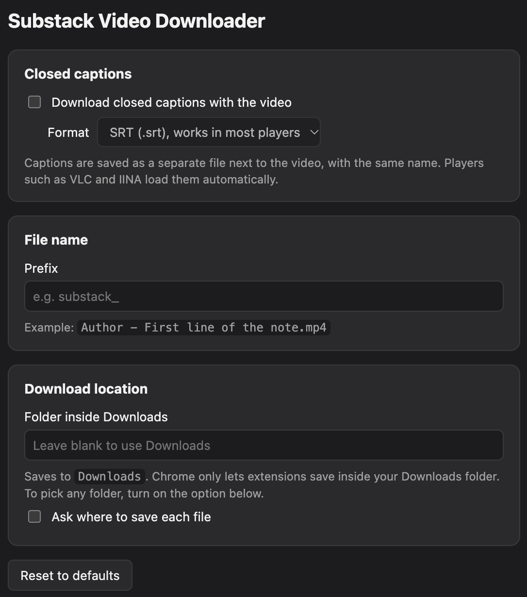

Substack Video Downloader (Chrome extension)
=====================================

Downloads the video on the Substack note or post you're viewing, with an optional closed-captions file.

## Install

1. Open `chrome://extensions`.
2. Turn on **Developer mode** (top right).
3. Click **Load unpacked** and select this folder.
4. Pin the extension from the puzzle-piece menu.

## Use

Open a note or page with videos embeded in them, then click the extension icon and **Download**.
> [!TIP]
> The note's or post's own video is listed first. Other videos on the page are listed below it.

## Settings

Click ⚙ in the popup or open the extension's **Options** page.

- **Closed captions**: on or off, saved as `.srt` or `.vtt` next to the video with the same name.
- **Prefix**: text added to the start of every file name.
- **Download location**: a folder inside `Downloads` (blank = `Downloads`). Chrome doesn't let
  extensions write outside `Downloads`. Turn on **Ask where to save each file** to choose any folder.

## How it works

Substack note videos are hosted on a remote server and uses api requests to embed the post.

The extension asks Substack's API for the full-quality MP4 file `/api/v1/video/upload/<id>/src?type=mp4`, and builds the captions file from the subtitle track in the HLS stream.

> [!CAUTION]
> Subscriber-only videos still wont work until you have access to them.